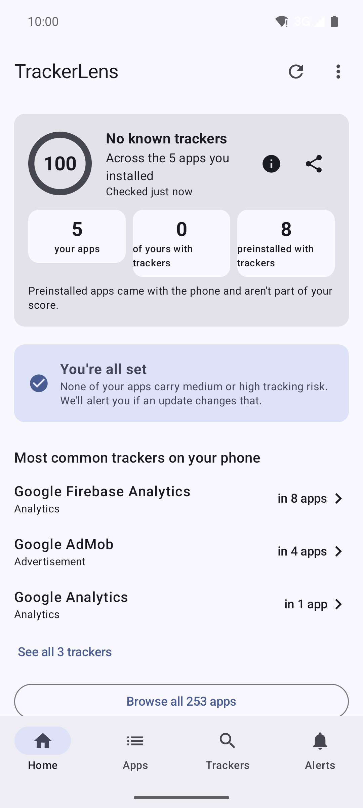
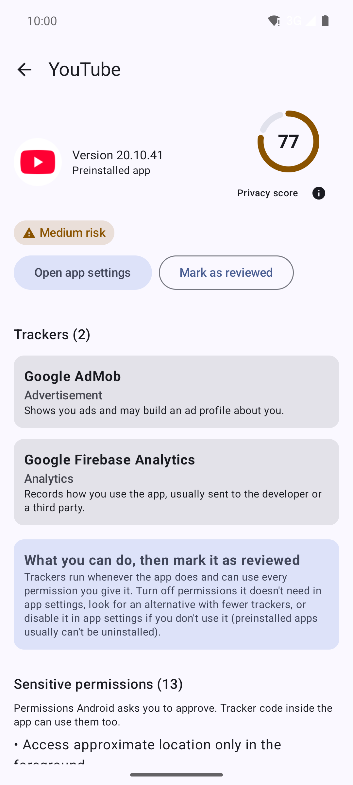
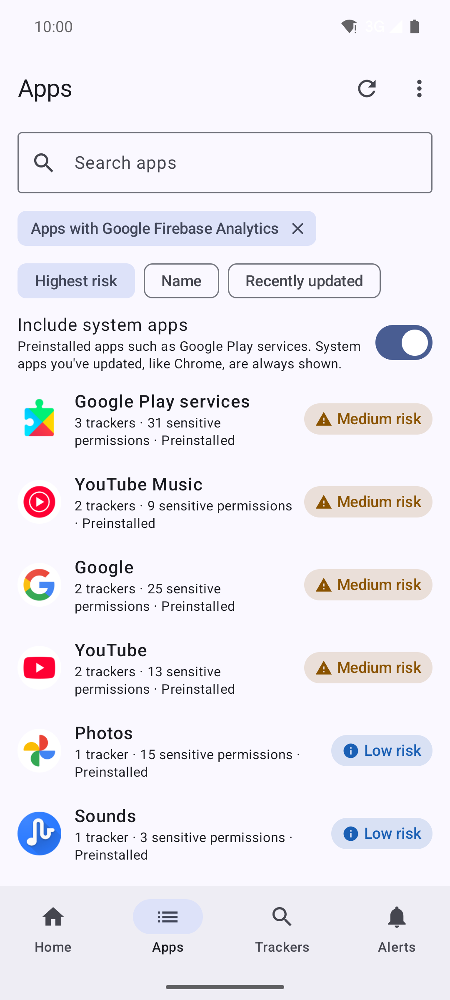
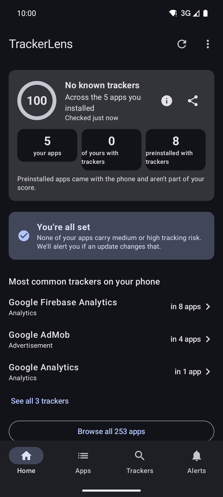
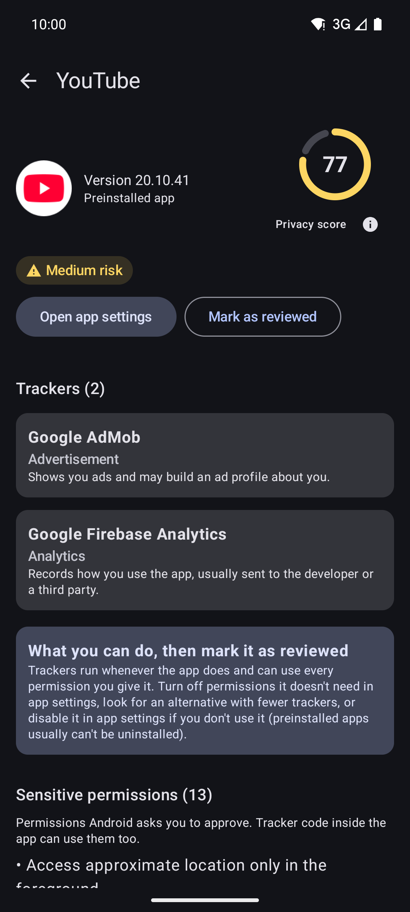
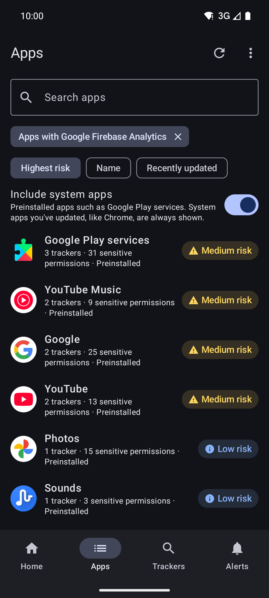
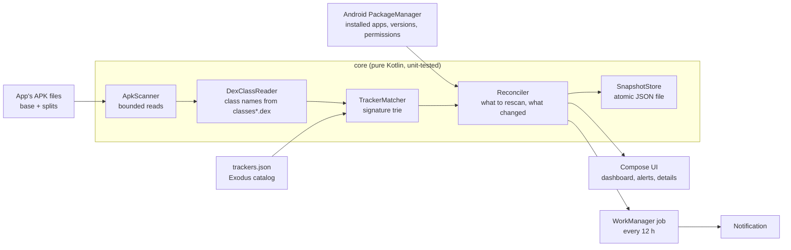
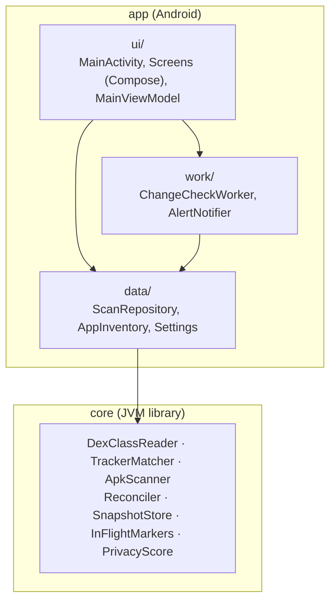

<p align="center">
  
</p>

<h1 align="center">TrackerLens</h1>

<p align="center">
  <b>See which companies' tracking code is inside the apps on your Android phone,<br>
  and get warned when an update quietly adds more.</b><br>
  On-device only · no internet permission · no ads · GPL-3.0
</p>

<table align="center">
  <tr>
    <td align="center"><b>Light</b></td>
    <td align="center"><b>Dark</b></td>
  </tr>
  <tr>
    <td>
      
      
      
    </td>
    <td>
      
      
      
    </td>
  </tr>
</table>

<p align="center"><sub>Follows your phone's theme by default; choose Light or Dark from the ⋮ menu. Screenshots: Android 16 emulator with system apps shown.</sub></p>

---

## Download

- **GitHub:** [latest release](https://github.com/payallenka/trackerlens/releases/latest) (APK, Android 9+)
- **Obtainium:** add `https://github.com/payallenka/trackerlens` to get updates automatically
- **F-Droid:** planned. F-Droid lists apps after three months of active maintenance; the build is already
  reproducible and passed F-Droid's checks, so it will be resubmitted in late January 2027

Verify the APK's signing certificate (SHA-256):
`5c:f6:e5:df:f9:1b:78:c6:70:b7:49:b2:39:d4:91:b5:5b:7e:cd:f6:02:b4:9a:79:fc:22:a0:39:0b:f1:1f:9a`

## Why

Android's Settings show which **permissions** an app has. They don't show which **companies' code**
runs inside it. Most tracking SDKs (analytics, ads, attribution) need no permission at all, they
inherit every permission the app already has, and they arrive silently with app updates.
TrackerLens reads each installed app's code on your phone and tells you who is in there.

## Features

- **Tracker scan** of every installed app against 428 known tracker SDKs from the
  [Exodus Privacy](https://exodus-privacy.eu.org) database, with the exact class found as proof.
- **Risk level and privacy score** per app and for the phone, weighted by tracker type
  (ads, profiling and location weigh more than crash reporting).
- **Update alerts**: a background check notifies you when an app update adds trackers or
  permissions, with a per-app update history and an in-app Alerts screen.
- **Most common trackers on your phone**, and which apps contain each one.
- **Sensitive permissions** per app, with a shortcut to the app's permission settings.
- Search, sort by risk, name or recent updates, optional system apps.
- Light and dark themes (follows the system, or choose in the ⋮ menu).

## Trackers it recognises

TrackerLens recognises **428 trackers** from the [Exodus Privacy](https://exodus-privacy.eu.org) database,
grouped here by their most invasive category. Full table with websites: [docs/TRACKERS.md](docs/TRACKERS.md).

| Category | Trackers |
|---|---|
| Advertisement | 119 |
| Analytics | 161 |
| Profiling | 4 |
| Identification | 7 |
| Location | 14 |
| Crash reporting | 11 |
| Other | 112 |
| **Total** | **428** |

<details>
<summary>Show all 428 trackers</summary>

**Advertisement (119)**: 360Dialog · Aarki · Actv8me · Ad Generation · AD(X) · Ad4Screen · AdAdapted · AdBuddiz · Adcash · Adcenix · AdColony · AdFalcon · Adfurikun · AdGateMedia · AdGem · Adjoe · AdLocus · AdMarvel · Admitad · Admixer · Admost · AdMuing · adPOPcorn · AdTiming · AdTrial · AerServ · Airpush · Alimama (formerly AdsMogo) · Altamob · Anvato (A Google Company) · AnySDK · AppLovin (MAX and SparkLabs) · Appodeal Stack · AppsGeyser · AppVador · Apsalar · Beintoo · BidMachine · Braze (formerly Appboy) · BuzzAd Benefit · CallDorado · Carto (formerly Nutiteq) · Cauly · Cifrasoft · ComScore · Coulus Coelib · DOV-E · Facebook Ads · fineboost · Flurry · FreeWheel · Fyber · Geniee · GOM Factory AdPie · Google AdMob · Huawei Mobile Services (HMS) Core · HyprMX · IAB Open Measurement · IBM Mobile Marketing (Acoustic) · Inneractive · Instreamatic (Adman) · IQzone · JumpTap · KIDOZ · Kiip · Kochava · LoopMe · MDOTM · mediba · Metaps · Mintegral · Moat · MobFox · MobPower · Moodmedia · myTarget · nend · OfferToro · Ooyala · OpenX · Pangle · Pincrux · PingStart · POKKT · Prebid Mobile · PredicIO · PubMatic · PubNative · Receptiv (formerly Mediabrix) · Revmob · RjFun · SK planet Tad · Snap Ad Kit · Solar2D (Corona) · Startapp · SuperAwesome · Synerise · TalkingData · Tapdaq · Taplytics · Tappx · Teads · TNK Factory · Twitter MoPub · Unity3d Ads · Upsight · Vdopia · Veloxity · Verizon Ads · Verve · Virgo Mobile · Vpon · Vungle · Yandex Ad · Yinzcam Sobek · Yoadx · YOC VIS.X · YuMe · Zapr

**Analytics (161)**: ABTasty · ACRCloud · Adbrix · Adjust · Adjust Unbotify · Akamai MAP · Alohalytics · Alooma · Alphonso · Amazon Analytics (Amazon insights) · Amazon Mobile Analytics (Amplify) · Amplitude · Anagog · Analytics by NPAW (Youbora Suite) · AppAnalytics · Appcelerator Analytics · Appdynamics · Applause · AppSee · AppsFlyer · Apptentive · Apptimize · Areametrics · ATInternet · Audience Studio (Krux) · Backelite · Baidu Mobile Stat · Batch · Bazaarvoice · BlueConic · BlueKai (acquired by Oracle) · Bolts · Branch · Bugfender · Button · Carnival · Chartbeat · CleverTap · Colocator · CoolaData · Countly · Cuebiq · deltaDNA · Demdex · Didomi · Dynamic Yield · Dynatrace · Ensighten · Estimote · Eulerian · ExactTarget · Exponea · Facebook Analytics · Facebook Audience · Facebook Flipper · FidZup · Flowsense · FLUZO · Foresee · fullstory · GameAnalytics · GIPHY Analytics · Google Analytics · Google Analytics Plugin (Cordova) · Google Firebase Analytics · Google Tag Manager · GPShopper · Heap · Herow · Huq Sourcekit · IBM Digital Analytics · IndoorAtlas · Insider · ironSource · JiGuang Aurora Mobile JPush · Keen · Kissmetrics · Kontakt · LeanPlum · Lenddo · Lisnr · Localytics · Loggly · LotaData · Marketo (an Adobe Company) · Matomo (Piwik) · Metrics · Microsoft Visual Studio App Center Analytics · MixPanel · Mobile Engagement · Mobvista · MOCA · MoEngage · Mopinion · mParticle · New Relic · Nielsen · Omniture · OneAudience · Opensignal · OpenTelemetry (OpenCensus, OpenTracing) · Optimizely · OzTAM · Parse.ly · Pendo · Placer · PlaytestCloud Event Tracking · Plexure · Point Inside · Proximi.io · Pyze · Quantcast · Radius Networks · Raygun · Repro · Retency · Reveal Mobile · Rubicon Project · S4M · SAP CDC (Gigya) · Scandit · Segment · Sense360 · Sensors Analytics · Shopkick · Signal360 · SilverPush · Singlespot · Singular · Sizmek · Snowplow · Split · Splunk MINT · Swrve · Sync2Ad · TagCommander (Commanders Act.) · Tamoco · TapResearch · Tapstream · Tealeaf · Tealium · Teemo · Tencent MTA · Tencent Stats · Tenjin · ThinkingData Analytics · Tinder Analytics · Treasure Data · Tune · Uber Analytics · UserExperior · UXCam · Vectaury · Weborama · Webtrekk · Webtrends · Wootric · X-Mode · Yueying Crash SDK · Zendrive · Zoho Analytics

**Profiling (4)**: Acuant · IPQualityScore · Pollfish · SmartLook

**Identification (7)**: AccountKit · Facebook Login · Houndify · Janrain · Jumio · Snapchat Login Kit · VKontakte SDK

**Location (14)**: AutoNavi / Amap · BeaconsInSpace (Fysical) · Blesh · Bluecats · Cedexis Radar · Esri ArcGIS · Footmarks · Glympse · HyperTrack · OpenLocate · Pilgrim by Foursquare · Roximity · SignalFrame · Unacast Pure

**Crash reporting (11)**: ACRA · Backtrace · Bugsee · BugSense · Bugsnag · Google CrashLytics · HockeyApp · Instabug · Microsoft Visual Studio App Center Crashes · Rollbar · Sentry

**Other (112)**: Add Apt Tr · AdFit (Daum) · Adform · Adincube · ADLIB · Adobe Experience Cloud · Adot · AdsWizz · AltBeacon · Amazon Advertisement · Amazon Mobile Associates · AMoAd · Amobee · AppBrain · AppMetrica · AppMonet · Appnext · AppNexus · Appodeal · Apteligent by VMWare (formerly Crittercism) · Auditude · Axonix · Baidu APPX · Baidu Location · Baidu Map · Baidu Maps · Baidu Mobile Ads · Baidu Navigation · Bitly · Brightcove · Bugly · ChartBoost · Cheetah Ads · Cloudmobi · Conversant · Conviva · Criteo · Display · Duapps · Emarsys Predict · Enhance · Facebook Notifications · Facebook Places · Facebook Share · Factual · Fiksu · flymob · FollowAnalytics · Fyber SponsorPay · Gemius HeatMap · Gimbal · Glispa Connect (Formerly Avocarrot) · HelpShift · Heyzap (bought by Fyber) · In Loco · INFOnline · InMarket · Inmobi · Inrix · Integral Ad Science · JW Player · Ligatus · Locuslabs · Lotame · MAdvertise · Mail.ru · maio by i-mobile · Mapbox · Millennial Media · Mozilla Telemetry · myTracker · NativeX · Nexage · Ogury Presage · OneSignal · OpenBack · OtherLevels · OutBrain · Persona.ly · Placed · Pusher · PushSpring · Pushwoosh · Qualtrics · Radar · Salesforce Marketing Cloud · Schibsted · ScoreLoop · Sensoro · Sentiance · ShallWeAD · Smaato · Smart · Soomla · Square Metrics · Supersonic Ads · Swirl · Taboola · Tapjoy · TeleQuid · Tencent Map LBS · Tencent MobWin · Tencent Weiyun · Tutela · Tutucloud · Twine Data · Umeng Analytics · Umeng Feedback · Urbanairship · WeChat Location · Widespace · YouAppi

</details>

## Privacy

| | |
|---|---|
| Network | **None.** The `INTERNET` permission is removed in the manifest and CI fails if it ever appears in a build. |
| Data stored | Scan results (app names, versions, trackers found, requested permissions, update history) and your settings (including which apps you marked as reviewed), in the app's private storage on the phone. |
| Backups | Excluded from Google cloud backup and device-to-device transfer. |
| Notifications | Lock screen shows only "An app update reduced your privacy"; not mirrored to watches. |
| Other apps | Read only (their installer files). Never executed or modified. |
| Ads, analytics, accounts | None. |

Full policy: [PRIVACY.md](PRIVACY.md).

## How it works



1. **List apps.** `QUERY_ALL_PACKAGES` gives the installed apps with version and permissions.
2. **Read class names.** For each app, every `classes*.dex` in its base and split APKs is read
   with a hard size limit. Only the DEX header and the class, type and string tables are
   touched; nothing is executed.
3. **Match.** Class names are walked through a character trie built from the catalog's code
   signatures. A signature matches only at a package or inner-class boundary, so
   `com.facebook.ads` matches `com.facebook.ads.AdView` but not `com.facebook.adsx.Thing`.
4. **Reconcile.** Only apps that are new, updated, or need re-matching after a catalog change
   are read again. When an app updates, the old and new results are compared; tracker
   differences are reported only if both reads were complete and used the same catalog.
5. **Alert.** The background job notifies about updates that added trackers or permissions.

### Robust against hostile apps

The input is untrusted code from other apps, so the scanner is built so that one malicious app
cannot blind it: DEX reads have a hard byte limit that ignores the size the archive claims,
class names are capped and ASCII-only, each type is decoded once, matching is linear, failures
are contained per APK, and an APK that crashes the scanner is quarantined until it updates.
This was tested on a device with a 45 KB APK that expands to a 37 MB DEX holding a 5 MB class
name and a million duplicate class entries.

## Architecture



| Module | Responsibility |
|---|---|
| `core/` | All scanning and decision logic, Android-free so it runs in plain JVM unit tests. |
| `app/data` | The only code that talks to `PackageManager` and storage; one `ScanRepository` per process, shared by UI and worker, with all state under one mutex. |
| `app/work` | Periodic check (WorkManager, every 12 h, battery not low) and the notification. |
| `app/ui` | Jetpack Compose screens and a ViewModel with derived state computed once per change. |
| `scripts/` | `update-trackers.mjs` regenerates the bundled catalog from Exodus (developers only). |

**Tech:** Kotlin 2.2, Jetpack Compose (Material 3), AndroidX ViewModel and WorkManager,
kotlinx.serialization, Gradle 8.14 with the Android Gradle Plugin 8.13. Android 9 (API 28) to
Android 16 (API 36). Release APK about 2.5 MB.

## What it cannot see

- Trackers in native code (`.so`), Flutter/Dart or React Native JavaScript.
- Code downloaded or unpacked at runtime, or apps protected by packers.
- A company's own in-house analytics: the catalog lists third-party SDKs.
- Trackers not in the Exodus database.
- Whether tracker code is **active**: TrackerLens shows it is present.

## Build

Requirements: JDK 17 or newer. The Gradle wrapper downloads Gradle (checksum-verified).

```sh
./gradlew :core:test          # unit tests, no Android SDK needed
./gradlew :app:assembleDebug  # needs an Android SDK (Android Studio installs one)
```

Works on Windows (`gradlew.bat`), macOS and Linux. Without a local Android SDK, push to GitHub:
the [build workflow](.github/workflows/build.yml) runs the tests, builds debug and release APKs,
checks neither has network access, and uploads the debug APK.

Debug builds install as `app.trackerlens.debug` beside the release app. End-to-end tests (the
first-run journey on a device, and the update-alert path) are described in
[CONTRIBUTING.md](CONTRIBUTING.md#end-to-end-tests-run-before-a-release-on-an-emulator-or-test-device).

### Release signing

Release builds are unsigned unless a `keystore.properties` file (git-ignored) exists in the project root:

```properties
storeFile=/absolute/path/outside/the/repo/release.jks
storePassword=...
keyAlias=trackerlens
keyPassword=...
```

### Updating the tracker catalog

```sh
node scripts/update-trackers.mjs   # Node 18+
```

Run it before a release, never from the app: Exodus asks end-user apps not to call its API.
Then regenerate the tracker list in this README's table and `docs/TRACKERS.md` with
`node scripts/tracker-list.mjs --compact`.

## Roadmap

About one release a month; see [milestones](https://github.com/payallenka/trackerlens/milestones) and
[CHANGELOG.md](CHANGELOG.md).

- **0.2.0** (Nov 2026): first-party analytics detection (e.g. in-house SDKs of large platforms), shown separately from third-party trackers
- **0.3.0** (Dec 2026): export a report (CSV/JSON) through the share sheet; text moved to string resources so the app can be translated
- **0.4.0** (Jan 2027): home-screen widget with the privacy score; first translations

The tracker catalog is refreshed from Exodus Privacy every month.

## Contributing

Issues and pull requests are welcome; see [CONTRIBUTING.md](CONTRIBUTING.md). Engineering,
UX and security reviews of the app are recorded in [docs/review-log.md](docs/review-log.md).
To report a security problem privately, see [SECURITY.md](SECURITY.md).

## License

- Code: [GPL-3.0-or-later](LICENSE).
- Tracker definitions in `app/src/main/assets/trackers.json`: derived from the Exodus Privacy
  database, [ODbL 1.0](TRACKER_DATA_LICENSE.md).
